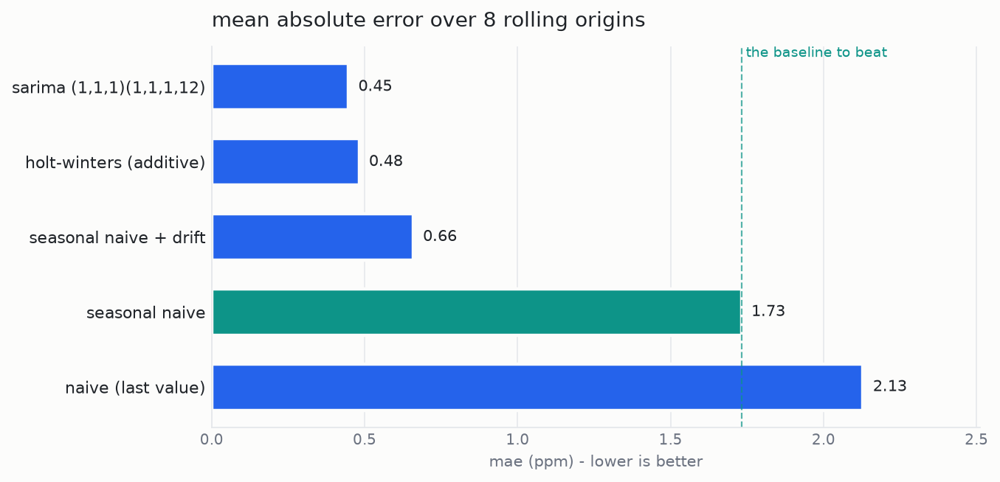
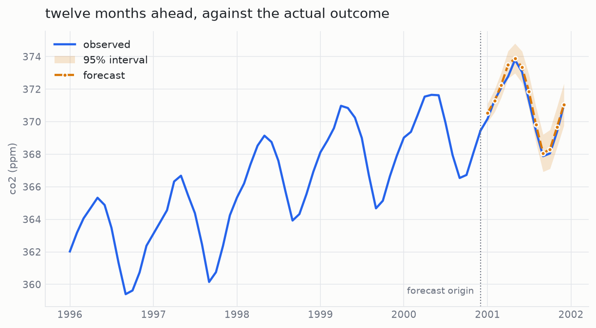
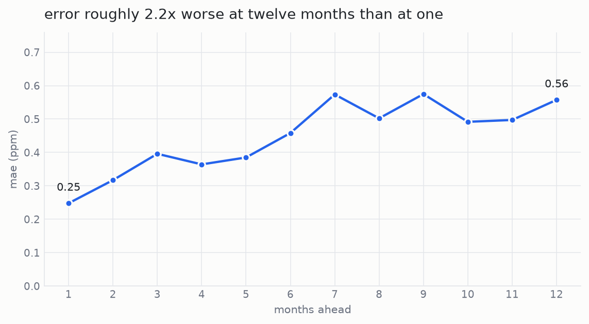

# Time-Series Forecasting with a Baseline-First Evaluation

A monthly forecasting pipeline that predicts 12 months ahead and — the actual
point — checks honestly whether the models beat the obvious guess.

Most forecasting write-ups stop at "my model got 0.45 MAE". That number means
nothing on its own. This one starts from the baselines, measures whether the
prediction intervals are telling the truth, and shows how much accuracy decays
the further out you look.

---

## The data

Mauna Loa atmospheric CO₂, via `statsmodels.datasets.co2`. Weekly readings from
March 1958 to December 2001, resampled to monthly means.

- **526** monthly observations
- **5** missing months, filled by time interpolation
- Strong upward trend, clean annual season — which is exactly why the baselines
  need to be good ones

## How it is evaluated

Rolling-origin backtest: **8 origins**, spaced a year apart, forecasting **12
months** from each. Every model is refit from scratch at every origin. Reusing a
single fit across origins would leak future data backwards and quietly flatter
every model on the list.

Four metrics: MAE, RMSE, MAPE, and MASE (scaled against a one-step naive
forecast on the training window, so 1.00 means "no better than naive").

---

## Results

Mean error across all 8 origins, 12-month horizon each:

| Model | MAE (ppm) | RMSE | MAPE | MASE | vs seasonal naive |
|---|---|---|---|---|---|
| **SARIMA(1,1,1)(1,1,1,12)** | **0.447** | 0.519 | 0.12% | 0.427 | **0.258** |
| Holt-Winters (additive) | 0.482 | 0.552 | 0.13% | 0.461 | 0.278 |
| Seasonal naive + drift | 0.658 | 0.742 | 0.18% | 0.629 | 0.380 |
| Seasonal naive | 1.732 | 1.788 | 0.47% | 1.655 | 1.000 |
| Naive (last value) | 2.129 | 2.534 | 0.58% | 2.035 | 1.230 |



SARIMA cuts the seasonal-naive error by roughly three quarters. Worth noting how
close **seasonal naive + drift** gets for a model that is four lines of
arithmetic and has no parameters to fit.

### The forecast against reality



### Do the 95% intervals actually contain the truth?

| Nominal | Empirical | Mean width | Intervals checked |
|---|---|---|---|
| 95% | **92.7%** | 1.91 ppm | 96 |

They do not, quite. The bands are slightly too narrow — the model is a little
more confident than its track record justifies. That is a small gap, but it is
the kind of thing that goes unmeasured almost everywhere.

### Accuracy decays with distance

| Months ahead | 1 | 2 | 3 | 4 | 5 | 6 | 7 | 8 | 9 | 10 | 11 | 12 |
|---|---|---|---|---|---|---|---|---|---|---|---|---|
| MAE (ppm) | 0.248 | 0.317 | 0.396 | 0.364 | 0.385 | 0.458 | 0.574 | 0.502 | 0.575 | 0.492 | 0.497 | 0.557 |



A 12-month forecast is about **2.2×** as wrong as a 1-month one. A single
headline accuracy figure hides that completely.

---

## What this project is actually demonstrating

**1. Baselines first, and the right baselines.**
Plain last-value naive scores a MASE of 2.04 — worse than doing nothing
seasonal at all. Pick that as your reference and every model looks like a
triumph. The honest comparison is against seasonal naive, and the genuinely
hard one is against seasonal naive + drift.

**2. Coverage measured, not assumed.**
Almost nobody checks whether their 95% intervals contain the truth 95% of the
time. Finding out they contain it 92.7% of the time, and saying so, matters more
than shaving another 0.01 off the MAE.

**3. Error growth quantified.**
Reporting one accuracy number for a 12-month forecast averages away the fact
that month 12 is twice as uncertain as month 1. Anyone planning against that
forecast needs to know it.

---

## Layout

```
.
├── README.md
├── requirements.txt
├── src/
│   ├── forecast.py      # data, models, metrics, backtest, coverage
│   └── plots.py         # the three figures
└── results/             # csvs and pngs, all generated
```

`load_series()` in `src/forecast.py` is the only function you touch to swap
datasets. It returns a monthly series with a clean index; everything downstream
is dataset-agnostic.

## Running it

```bash
pip install -r requirements.txt
python src/forecast.py
python src/plots.py
```

Roughly 15 seconds for the backtest. Every number quoted in this README is read
from the generated CSVs — nothing here is typed by hand.

## Next

Re-point `load_series()` at real operational data (SEAI or EirGrid grid
demand). The mess in live operational series — outages, revisions, holiday
effects — surfaces failure modes that a clean atmospheric record never will.
