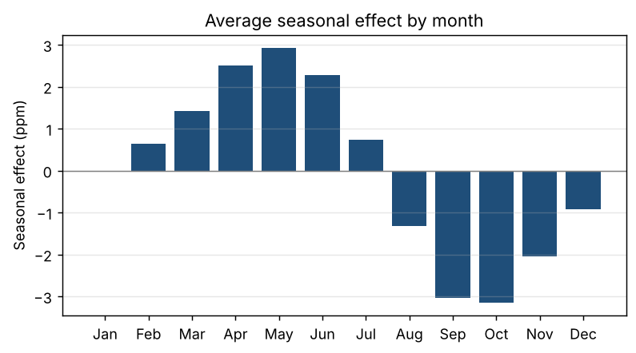

# forecast

Monthly time-series forecasting built around **honest validation**: does a
statistical model actually beat a naive baseline, and can its stated confidence
be trusted?

> **Status:** work in progress. Step 1 (load and explore) is done. The other
> sections below are placeholders. No results are reported until the
> evaluation behind them exists.

| Step | What | Status |
|---|---|---|
| 1 | Load and explore | ✅ done |
| 2 | Baselines (naive, seasonal naive, seasonal naive + drift) | ⏳ |
| 3 | Models (SARIMA, Holt-Winters) | ⏳ |
| 4 | Rolling-origin backtest | ⏳ |
| 5 | Metrics (MAE, RMSE, MAPE, MASE) | ⏳ |
| 6 | Prediction-interval coverage | ⏳ |
| 7 | Horizon decay | ⏳ |
| 8 | Tests and reproducibility | 🟡 data tests only |
| 9 | README write-up | 🟡 data section only |

---

## The question

Can a statistical model beat the hardest naive baseline on this series, and
when it says it is 95% confident, is it right 95% of the time?

## Data

Mauna Loa atmospheric CO₂ (ppm), from `statsmodels.datasets.co2`.

| | |
|---|---|
| Raw | 2,284 weekly readings, Mar 1958 – Dec 2001 |
| Raw gaps | 59 weeks missing (2.58%), last one in Aug 1985 |
| Modelled | **526 monthly observations**, Mar 1958 – Dec 2001 |
| Cleaning | weekly → month-start means. 5 months with no readings at all are filled by time interpolation. Edge gaps are dropped, never extrapolated. |
| Range | 313.4 – 373.8 ppm |

All figures come from `results/data_summary.csv`, written by
`python -m src.explore`.


### What the exploration shows


- **Strong, accelerating trend.** The trend rises on average **0.83 ppm/year**
  in the first ten years and **1.52 ppm/year** in the last ten. The growth rate
  roughly doubles over the period, so a straight-line drift is a
  simplification.
- **Clean, stable annual seasonality.** It peaks in **May** and bottoms out in
  **October**, with a peak-to-trough amplitude of about **6.1 ppm**. The shape
  barely changes over 44 years, so additive seasonality looks appropriate.
- **Small residuals.** After removing trend and season, the residual standard
  deviation is **0.28 ppm**. Most of the series can be explained by structure.



**What this means for later steps.** With a trend this strong, the plain naive
forecast ("last value carried forward") will be weak. With a seasonal pattern
this regular, seasonal naive plus drift will probably be the hard baseline to
beat. That is a hypothesis for Step 2, not a result yet.

> The decomposition above uses the full series and is for exploration only.
> Nothing computed on the full series is ever passed to a model. Every fit will
> use only its own training window.

## Method

_To do: baselines, models, rolling-origin design, metrics._

## Results

_To do: MASE against the hardest baseline, interval coverage, horizon decay._

## What I found

_To do._

## Limitations

- Filling missing months with time interpolation uses the readings on both
  sides of the gap. That matters for 5 of 526 months, all in 1958 or 1964 (including a three-month gap, Feb–Apr 1964),
  but it is technically information from the future.
- _More to come as the evaluation is built._

## How to run it

```bash
python -m venv .venv
source .venv/bin/activate        # Windows: .venv\Scripts\activate
pip install -r requirements.txt

python -m src.explore            # step 1: summary + figures into results/
python -m pytest                 # tests
```

## Repo layout

```
forecast/
├── README.md
├── requirements.txt
├── data/                 # notes on data sources (co2 ships with statsmodels)
├── src/
│   ├── data.py           # loading, missing-value report, monthly resampling
│   ├── plots.py          # figures
│   └── explore.py        # step 1 entry point
├── tests/
│   └── test_data.py
└── results/
    ├── data_summary.csv
    └── figures/
```
