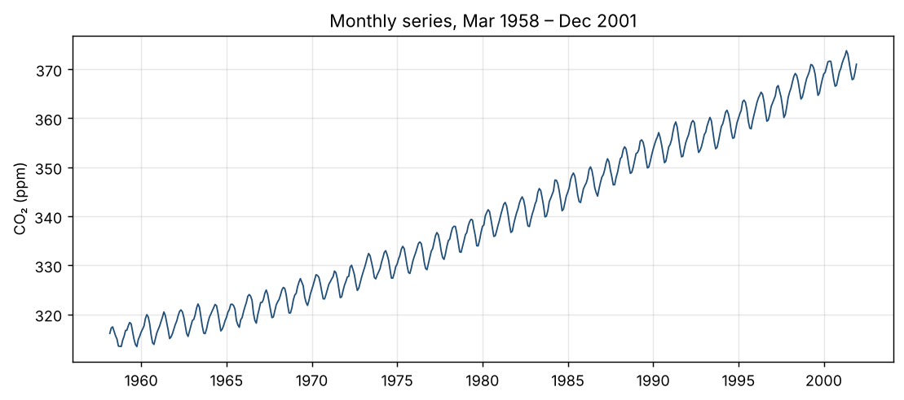
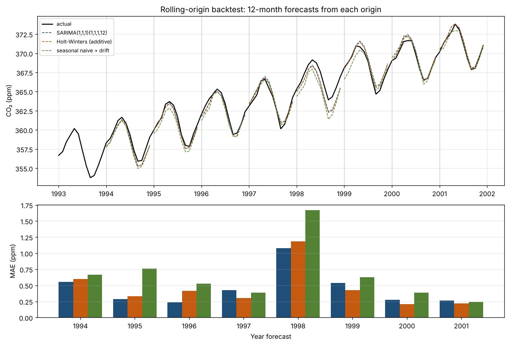
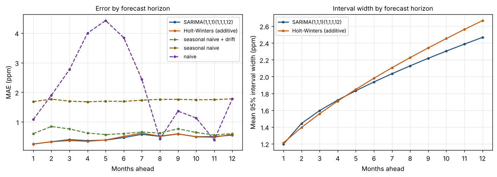

# forecast

SARIMA and Holt-Winters forecasts of monthly CO₂, tested against naive
baselines with a rolling-origin backtest, interval coverage and horizon decay.

## The question

Can a statistical model beat the hardest naive baseline on this series, and
when it says it is 95% confident, is it right 95% of the time?

## Data

Mauna Loa atmospheric CO₂ (ppm), from `statsmodels.datasets.co2`. 2,284 weekly
readings are averaged into **526 monthly observations, Mar 1958 – Dec 2001**.
The 5 months with no readings are filled by time interpolation.

The series has a strong, accelerating trend (0.83 ppm/year in the first decade,
1.52 in the last) and a stable annual cycle of about 6 ppm.



## Method

- **Baselines first.** Naive (last value), seasonal naive (same month last
  year) and seasonal naive + drift (plus the average yearly rise). Drift is
  by far the hardest to beat, so it is the headline benchmark.
- **Models.** SARIMA(1,1,1)(1,1,1,12) and additive Holt-Winters, fitted as
  ETS(A,A,A) so it gives prediction intervals. Neither is tuned.
- **Rolling-origin backtest.** 8 origins a year apart, forecasting each year
  from 1994 to 2001, 12 months ahead. Every forecaster is refit from scratch
  at every origin on data before that origin only, giving 96 forecasts each.
- **Metrics.** MAE, RMSE, MAPE and MASE, plus relative MAE: each model's error
  divided by the drift baseline's at the same origin (below 1 beats it).
- **Interval coverage.** The share of actual values inside the 95% intervals,
  with a Wilson range for how much that share could move by chance.
- **Horizon decay.** Error grouped by months ahead, comparing 12 months
  ahead with 1 month ahead.

## Results

**Accuracy** (mean over 8 origins, 12 months ahead each):

| Forecaster | MAE (ppm) | MASE | Relative MAE vs drift | Beats drift baseline |
|---|---|---|---|---|
| SARIMA | 0.457 | 0.437 | **0.759** | 6 of 8 years |
| Holt-Winters | 0.461 | 0.441 | **0.718** | 8 of 8 years |
| Seasonal naive + drift | 0.658 | 0.629 | 1.000 | – |
| Seasonal naive | 1.732 | 1.655 | 3.126 | 0 of 8 |
| Naive | 2.129 | 2.035 | 4.162 | 0 of 8 |



**Interval coverage** (96 intervals per model, nominal 95%):

| Model | Coverage | Wilson 95% range | Misses in 1998 |
|---|---|---|---|
| SARIMA | 92.7% | 85.7% – 96.4% | 7 of 7 |
| Holt-Winters | 91.7% | 84.4% – 95.7% | 7 of 8 |

**Horizon decay** (MAE 12 months ahead ÷ MAE 1 month ahead):

| Model | 1 month | 12 months | Ratio | Ratio without 1998 |
|---|---|---|---|---|
| SARIMA | 0.254 | 0.558 | **2.20×** | 1.72× |
| Holt-Winters | 0.259 | 0.586 | **2.27×** | 1.80× |
| Seasonal naive + drift | 0.606 | 0.609 | 1.00× | 0.89× |



## What I found

Both models beat the hardest baseline, cutting its error by about a quarter.
Most of that edge is short-range, though: 12 months out they are only 4–8%
better. Their 95% intervals cover 92–93% of actuals, which is close to honest
overall. The surprise was that almost every miss came in one year, 1998,
always above the interval. So the intervals hold in ordinary years and fail in
the year it matters most. The choice of benchmark also mattered more than the
choice of model: judged by MASE, even the drift baseline looks strong (0.63).

The full step-by-step write-up, with every table, is in
[docs/walkthrough.md](docs/walkthrough.md).

## How to run it

Needs Python 3.12 or newer.

```bash
python -m venv .venv
source .venv/bin/activate        # Windows: .venv\Scripts\activate
pip install -r requirements.txt

python -m src.run_all            # every step, about 15 seconds
python -m pytest                 # all tests
```

Each step also runs on its own, e.g. `python -m src.run_backtest`. Steps 5–7
read the backtest output, so run step 4 first.

## Tests and reproducibility

- **No leakage:** tests check that every forecaster only ever trains on data
  before its origin. Wrecking later data must not change earlier forecasts.
- **Metrics** are checked against hand-worked examples.
- **Data loader** tests cover missing weeks, empty months, unsorted and
  duplicate readings.
- **Reproducible:** dependencies are pinned and nothing in the pipeline is
  random. A test reruns the backtest and checks it matches the committed
  results. `scripts/check_clean_clone.sh` clones the repo, installs from
  scratch, runs everything, and fails if any result changes.

`python -m pytest -m "not slow"` skips the model-fitting tests (about 2
seconds instead of 20).
