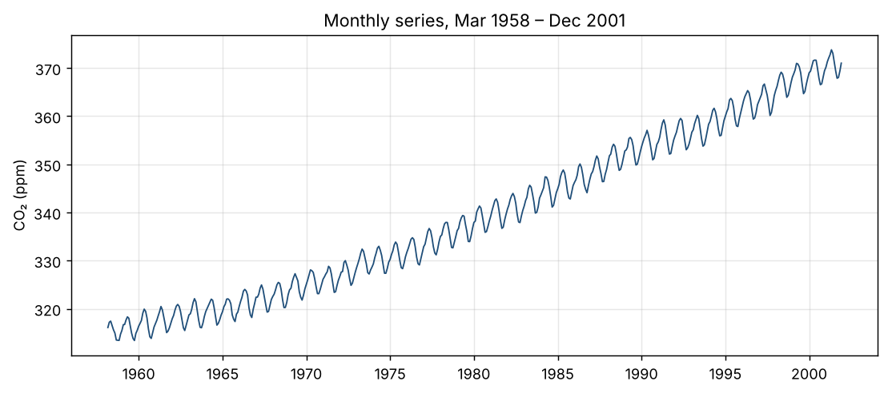
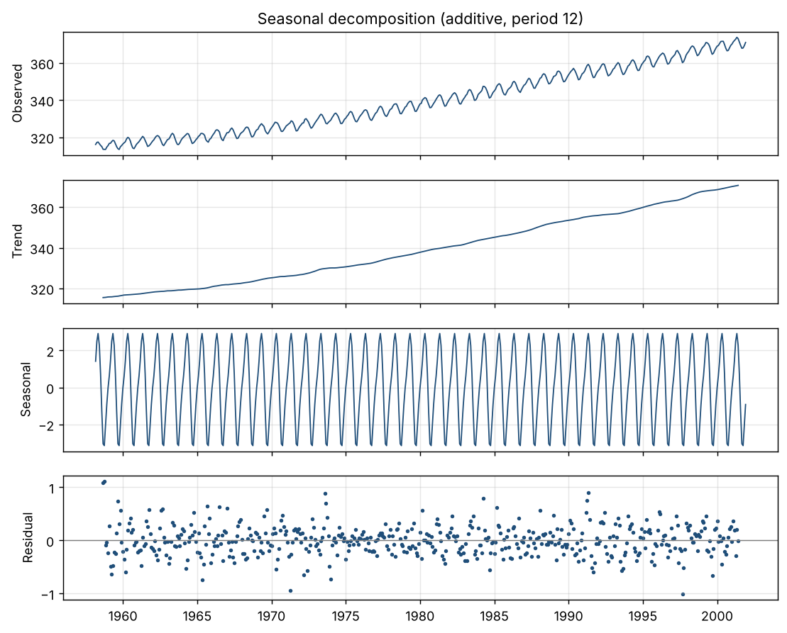
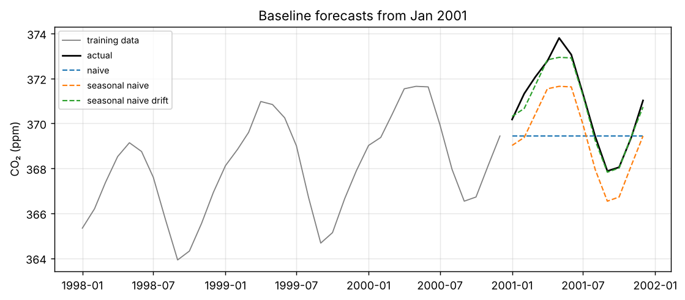
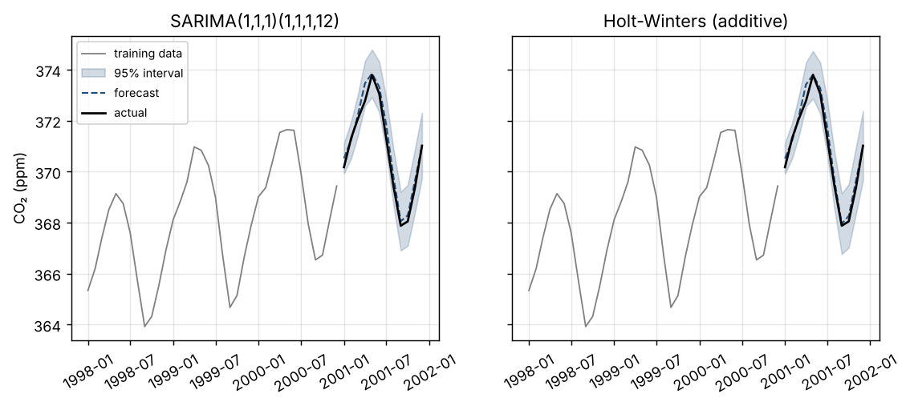

# forecast

Monthly time-series forecasting with honest validation: can a statistical model
beat a naive baseline, and can its stated confidence be trusted?

## Data

Mauna Loa atmospheric CO₂ (ppm) from `statsmodels.datasets.co2`: weekly readings
resampled to **526 monthly observations** (Mar 1958 – Dec 2001). 5 months with
no readings are filled by time interpolation.



## Exploration



- **Trend:** strong and accelerating, from 0.83 ppm/year in the first decade
  to 1.52 ppm/year in the last.
- **Seasonality:** stable annual cycle, peaking in May and bottoming out in
  October (about 6.1 ppm peak to trough).
- **Residuals:** small (std 0.28 ppm).

## Baselines

Three naive forecasts, each predicting 12 months ahead from 8 yearly cut
points (1994–2001), using only data before each cut point:

| Baseline | Mean MAE (ppm) | Worst MAE (ppm) |
|---|---|---|
| Seasonal naive + drift | **0.659** | 1.671 |
| Seasonal naive | 1.732 | 2.914 |
| Naive (last value) | 2.129 | 2.418 |



**Seasonal naive + drift is the benchmark.** Its error is about a third of the
plain seasonal naive's error. Comparing models against seasonal naive would
make any of them look far better than it really is.

## Models

- **SARIMA(1,1,1)(1,1,1,12)**
- **Holt-Winters**, additive trend and season, fitted as ETS(A,A,A) to get
  prediction intervals

Both models refit from scratch on whatever training window they are given and
return 95% prediction intervals. As a sanity check, each one is fitted on data
up to Dec 2000 and forecasts 2001:

| Model | Residual std (ppm) | Ljung-Box p | 2001 MAE (ppm) |
|---|---|---|---|
| SARIMA | 0.313 | 0.564 | 0.265 |
| Holt-Winters | 0.300 | 0.256 | 0.222 |
| Seasonal naive + drift | – | – | 0.242 |



Both models leave no significant pattern in their residuals (Ljung-Box
p > 0.05). On this single year, SARIMA does slightly *worse* than the drift
baseline. One split proves little either way, so the comparison that counts
is the rolling-origin backtest.

## How to run it

```bash
python -m venv .venv
source .venv/bin/activate        # Windows: .venv\Scripts\activate
pip install -r requirements.txt

python -m src.explore            # step 1: summary + figures
python -m src.compare_baselines  # step 2: baseline comparison
python -m src.fit_models         # step 3: model fit + diagnostics
python -m pytest                 # tests
```
