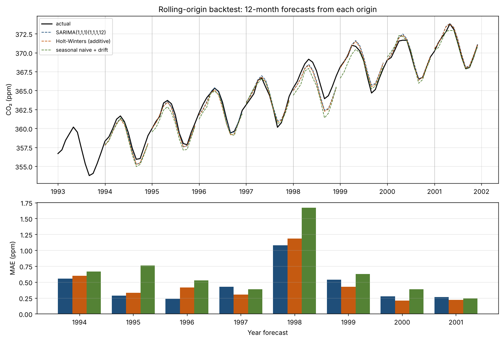
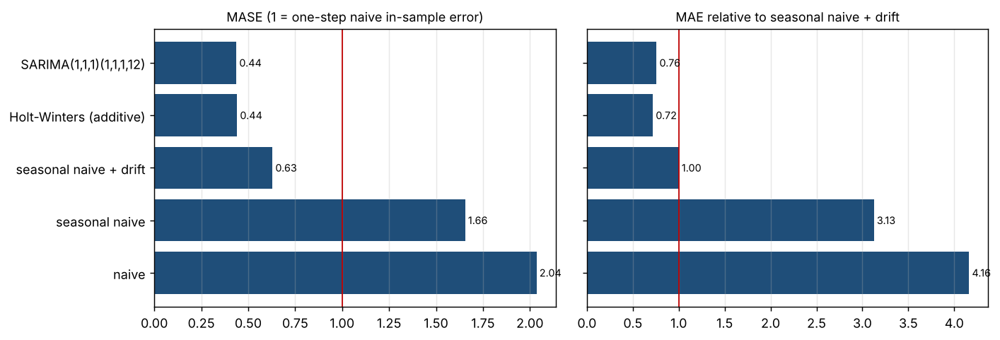
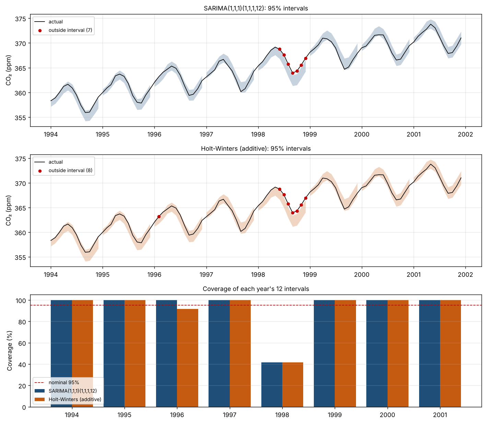

# forecast

Monthly time-series forecasting with honest validation: can a statistical model
beat a naive baseline, and can its stated confidence be trusted?

## Data

Mauna Loa atmospheric CO₂ (ppm) from `statsmodels.datasets.co2`: weekly readings
resampled to **526 monthly observations** (Mar 1958 – Dec 2001). 5 months with
no readings are filled by time interpolation.


## Exploration


- **Trend:** strong and accelerating, from 0.83 ppm/year in the first decade
  to 1.52 ppm/year in the last.
- **Seasonality:** stable annual cycle, peaking in May and bottoming out in
  October (about 6.1 ppm peak to trough).
- **Residuals:** small (std 0.28 ppm).

## Baselines

Three naive forecasts, each predicting 12 months ahead from 8 yearly cut
points (1994–2001), using only data before each cut point:

| Baseline | Mean MAE (ppm) | Worst MAE (ppm) |
|---|---|---|
| Seasonal naive + drift | **0.658** | 1.671 |
| Seasonal naive | 1.732 | 2.914 |
| Naive (last value) | 2.129 | 2.418 |


**Seasonal naive + drift is the benchmark.** Its error is about a third of the
plain seasonal naive's error. Comparing models against seasonal naive would
make any of them look far better than it really is.

## Models

- **SARIMA(1,1,1)(1,1,1,12)**
- **Holt-Winters**, additive trend and season, fitted as ETS(A,A,A) to get
  prediction intervals

Both models refit from scratch on whatever training window they are given and
return 95% prediction intervals. As a sanity check, each one is fitted on data
up to Dec 2000 and forecasts 2001:

| Model | Residual std (ppm) | Ljung-Box p | 2001 MAE (ppm) |
|---|---|---|---|
| SARIMA | 0.313 | 0.564 | 0.265 |
| Holt-Winters | 0.300 | 0.256 | 0.222 |
| Seasonal naive + drift | – | – | 0.242 |


Both models leave no significant pattern in their residuals (Ljung-Box
p > 0.05). On this single year, SARIMA does slightly *worse* than the drift
baseline. One split proves little either way, so the comparison that counts
is the rolling-origin backtest.

## Backtest

8 origins a year apart (forecasting 1994 through 2001), 12 months ahead from
each. Every forecaster is refit from scratch at every origin on data before
that origin only. That gives 96 forecasts per forecaster, all saved in
`results/backtest.csv`.

MAE (ppm) of each 12-month forecast:

| Forecaster | 1994 | 1995 | 1996 | 1997 | 1998 | 1999 | 2000 | 2001 | Mean |
|---|---|---|---|---|---|---|---|---|---|
| SARIMA | 0.552 | 0.286 | 0.239 | 0.427 | 1.077 | 0.538 | 0.277 | 0.265 | **0.457** |
| Holt-Winters | 0.599 | 0.333 | 0.413 | 0.301 | 1.185 | 0.427 | 0.211 | 0.222 | **0.461** |
| Seasonal naive + drift | 0.668 | 0.759 | 0.527 | 0.389 | 1.671 | 0.626 | 0.386 | 0.242 | 0.658 |
| Seasonal naive | 1.862 | 1.971 | 1.760 | 1.109 | 2.914 | 1.611 | 1.136 | 1.493 | 1.732 |
| Naive | 2.353 | 2.150 | 2.288 | 1.967 | 2.418 | 2.056 | 1.883 | 1.919 | 2.129 |



- Both models beat the drift baseline on average, by about 30%.
- Holt-Winters beats it in all 8 years. SARIMA beats it in 6 of 8: it loses
  in 1997 and 2001, the year the single split in Step 3 happened to pick.
- 1998 is the hardest year for every forecaster. CO₂ rose faster than any of
  them expected.
- The two models are close: SARIMA has the lower mean, but Holt-Winters wins
  in 4 of the 8 years.

## Metrics

Mean over the 8 backtest origins. MASE is scaled by the one-step naive error
on each origin's own training window. **Relative MAE** compares each model
with seasonal naive + drift at the same origin (below 1 beats it).

| Forecaster | MAE (ppm) | RMSE (ppm) | MAPE | MASE | Relative MAE | Beats drift baseline |
|---|---|---|---|---|---|---|
| SARIMA | 0.457 | 0.529 | 0.125% | 0.437 | **0.759** | 6 of 8 |
| Holt-Winters | 0.461 | 0.531 | 0.127% | 0.441 | **0.718** | 8 of 8 |
| Seasonal naive + drift | 0.658 | 0.742 | 0.181% | 0.629 | 1.000 | – |
| Seasonal naive | 1.732 | 1.788 | 0.475% | 1.655 | 3.126 | 0 of 8 |
| Naive | 2.129 | 2.534 | 0.582% | 2.035 | 4.162 | 0 of 8 |



- **MASE flatters every model here.** Even the drift baseline scores 0.63, as
  if it were a strong model. MASE measures against one-step naive, and on a
  seasonal series that is an easy bar. Relative MAE against the drift baseline
  is the honest headline: both models cut its error by about a quarter.
- **SARIMA has the lower average MAE, but Holt-Winters has the better relative
  MAE.** SARIMA wins big in a few years. Holt-Winters wins every year.
- MAPE is tiny (about 0.13%) because CO₂ sits around 360 ppm. It says little
  here.

## Interval coverage

How often did the actual value land inside the model's 95% prediction
interval? There are 96 intervals per model (8 origins × 12 months).

| Model | Inside | Coverage | Wilson 95% range | Mean width (ppm) | Missed below / above |
|---|---|---|---|---|---|
| SARIMA | 89 / 96 | **92.7%** | 85.7% – 96.4% | 1.94 | 0 / 7 |
| Holt-Winters | 88 / 96 | **91.7%** | 84.4% – 95.7% | 2.01 | 0 / 8 |



- **Overall, both models are slightly overconfident.** But with 96 intervals,
  95% is still inside the plausible range, so the shortfall on its own is not
  conclusive.
- **The misses are not spread out.** 14 of the 15 fall in 1998, and every one
  is *above* the interval. In 1998 both models covered only 5 of 12 months.
  In every other year coverage was 92–100%.
- So the intervals are honest in ordinary years but break down in an unusual
  one. Anyone planning around them would have been caught out in exactly the
  year it mattered most.
- The Wilson range treats each interval as independent. The 12 intervals from
  one origin are not (1998 shows that), so the true uncertainty is wider still.

## How to run it

```bash
python -m venv .venv
source .venv/bin/activate        # Windows: .venv\Scripts\activate
pip install -r requirements.txt

python -m src.explore            # step 1: summary + figures
python -m src.compare_baselines  # step 2: baseline comparison
python -m src.fit_models         # step 3: model fit + diagnostics
python -m src.run_backtest       # step 4: rolling-origin backtest
python -m src.evaluate           # step 5: metrics
python -m src.coverage           # step 6: interval coverage
python -m pytest                 # tests
```
